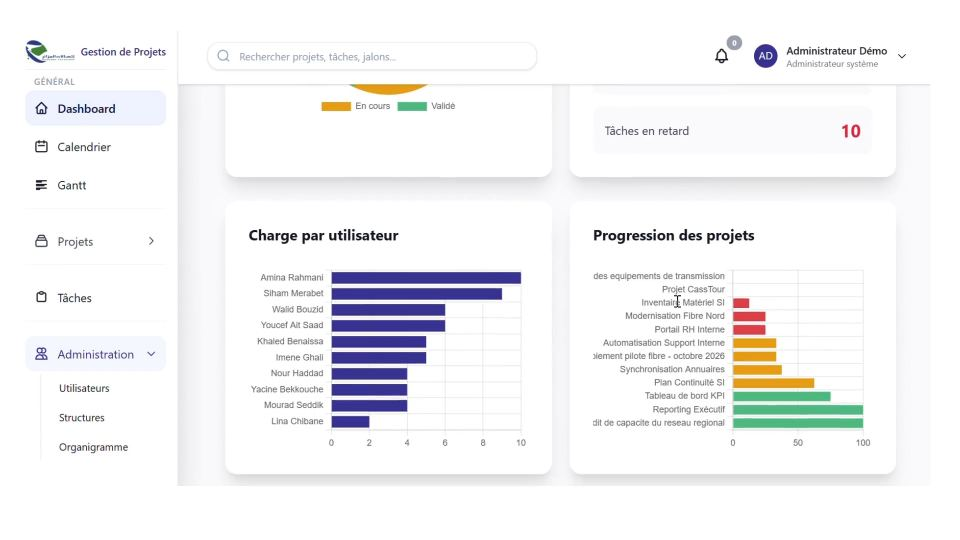

# Project Management System

## Plateforme de pilotage de projets pour Algérie Télécom

Project Management System est une plateforme web de gestion de projets conçue pour structurer le pilotage des activités d'Algérie Télécom. Elle centralise les projets, jalons, tâches, équipes et structures organisationnelles dans un espace sécurisé, lisible et adapté aux responsabilités de chaque utilisateur.

L'objectif est de fournir aux équipes une vision fiable de l'avancement, des échéances et des responsabilités, tout en garantissant un accès strictement contrôlé aux données.

## Aperçu



*Vue du tableau de bord administrateur de Project Management System.*

## Fonctionnalités principales

- **Tableaux de bord par rôle** : indicateurs d'activité, progression, échéances et tâches à traiter.
- **Gestion du cycle de vie des projets** : création, suivi, clôture et validation des projets.
- **Jalons et tâches** : planification, échéances, statuts, progression et assignation à un ou plusieurs membres.
- **Suivi des dépendances** : organisation des tâches et identification des impacts sur le calendrier.
- **Gestion des équipes** : projets et tâches visibles selon le département, le rôle et les responsabilités.
- **Organigramme interactif** : visualisation des structures organisationnelles et de leurs relations hiérarchiques.
- **Calendrier et notifications** : suivi des échéances, affectations et événements importants.
- **Collaboration** : commentaires et pièces jointes associés aux projets et aux tâches.
- **Contrôle d'accès** : politiques et middleware Laravel pour isoler les données par périmètre fonctionnel.

## Rôles et responsabilités

| Rôle | Périmètre principal |
| --- | --- |
| Administrateur | Administration complète des utilisateurs, structures et données de la plateforme |
| Chef de département | Pilotage des projets et équipes de son département |
| Chef de projet | Gestion des projets dont il est responsable et validation de leur avancement |
| Membre | Consultation et validation de ses tâches assignées |

## Architecture technique

- **Backend** : PHP 8.2+, Laravel 12
- **Base de données** : MySQL
- **Frontend** : Blade, Vue.js, Vite et Tailwind CSS
- **Visualisation** : Vue Flow et Dagre pour l'organigramme
- **Authentification** : Laravel Breeze et contrôle d'accès par rôles
- **Tests et qualité** : PHPUnit, Laravel Pint et contrôles PHP

L'application suit une architecture MVC et s'appuie sur les Policies Laravel, les middlewares d'authentification et le scoping des requêtes pour protéger les données.

## Installation

### Prérequis

- PHP 8.2 ou supérieur
- Composer
- Node.js et npm
- MySQL

### Mise en route

```bash
git clone https://github.com/phaghidow/project-management-pfe.git
cd project-management-pfe
composer install
cp .env.example .env
php artisan key:generate
php artisan migrate --seed
npm install
npm run build
php artisan serve
```

Configurez ensuite les paramètres de connexion à la base de données dans `.env`. Pour le développement, `npm run dev` lance le serveur Vite en mode surveillance.

## Documentation

- [Cahier des charges](docs/cahier-des-charges.md)
- [Licence GNU GPL v3.0](LICENSE)

## Positionnement du projet

Cette solution constitue un socle évolutif pour la digitalisation du suivi de projets : elle peut être enrichie par de nouveaux indicateurs, workflows de validation, notifications et modules métiers sans remettre en cause son organisation fonctionnelle.

## Licence

Project Management System est distribué sous licence [GNU General Public License v3.0](LICENSE).
